# 현재 DB 구조

> 상태: 현재 기준
> 확인일: 2026-10-09
> 기준: HEAD `54a8841` + 미커밋 작업 트리. 모델 선언 AST로 생성.

관련 소스: [models.py](../../backend/app/db/models.py). DB나 원문을 열지 않고 선언을 읽었다.

## 읽는 순서

계약→문서→추출/원본/버전→검사→업무 요청/결재/지급으로 읽는다. 사용자·세션·회사 설정은 인증과 정책 영역이다. 현재 선언은 27테이블이다. 기존 계정/email_verifications 등 호환용 테이블도 포함한다.

| 영역 | 테이블 |
| --- | --- |
| 계정·회사 | app_users, email_verifications, pilot_user_profiles, pilot_auth_sessions, pilot_company_settings |
| 계약·문서 | contracts, documents, document_maskings, document_extracts, business_verification, validation_results |
| 원본·버전·업로드 | pilot_document_files, pilot_document_versions, pilot_document_upload_jobs |
| 업무·검토 | pilot_contract_workflows, pilot_contract_reviews, pilot_approval_signoffs, pilot_work_assignments |
| 요청·회신 | pilot_resubmission_requests, pilot_request_bundles, pilot_request_bundle_items |
| 지급·이력 | pilot_contract_payments, pilot_payment_confirmations, pilot_audit_events |

## 선언된 스키마

각 Column·PK·명시 ForeignKey·단일 unique를 표시한다. FK가 PK에 포함되면 식별 관계, 그 외는 비식별 관계로 표시했다. nullable 외래키는 0~1 부모를 허용한다. 부모 쪽 참여 최솟값은 0이다. Mermaid 표기 기준은 [공식 ERD 문서](https://mermaid.js.org/syntax/entityRelationshipDiagram.html)를 따른다.

```mermaid
erDiagram
    app_users {
        Integer user_id PK
        String email UK
        String password
    }
    email_verifications {
        Integer id PK
        String email
        String code
        String verification_token
        DateTime expires_at
        Boolean is_verified
        Integer attempt_count
        DateTime created_at
    }
    contracts {
        Integer contract_id PK
        Integer user_id FK
        String title
        String vendor_name
        String business_number
        Float contract_amount
        String review_status
        DateTime created_at
        DateTime updated_at
    }
    pilot_contract_exclusions {
        Integer contract_id PK,FK
        String actor_name
        DateTime created_at
    }
    pilot_registration_attempts {
        Integer attempt_id PK
        Integer actor_id
        String request_key
        String payload_sha256
        Integer contract_id FK
        Text receipts_json
    }
    pilot_payment_corrections {
        Integer correction_id PK
        Integer payment_id FK
        String action
        Text snapshot_json
        Text reason
        String actor_name
        DateTime created_at
    }
    documents {
        Integer document_id PK
        Integer contract_id FK
        String file_name
        String storage_path
        String document_type
        Float class_confidence
        String processing_status
        DateTime uploaded_at
    }
    document_maskings {
        Integer masking_id PK
        Integer document_id FK,UK
        String masked_file_path
        String masking_status
        Integer masked_item_count
        Text masked_types
        DateTime processed_at
    }
    document_extracts {
        Integer extract_id PK
        Integer document_id FK,UK
        String extracted_vendor_name
        String extracted_vendor_reg_no
        Float extracted_amount
        String extracted_date
        String extracted_status
        Float confidence
        Text raw_fields
    }
    business_verification {
        Integer verification_id PK
        Integer document_id FK,UK
        String business_number
        String business_status
        DateTime verified_at
    }
    validation_results {
        Integer validation_id PK
        Integer contract_id FK
        Integer extract_id FK
        String validation_type
        Boolean is_match
        String status
        String field
        Text expected
        Text actual
        Text memo
        DateTime created_at
    }
    pilot_user_profiles {
        Integer user_id PK,FK
        String role
        String display_name
        Boolean active
        Boolean must_change_password
    }
    pilot_auth_sessions {
        String token_hash PK
        Integer user_id FK
        DateTime expires_at
    }
    pilot_company_settings {
        String key PK
        Text value
    }
    pilot_contract_workflows {
        Integer contract_id PK,FK
        Integer revision
        String amount_basis
        Float tax_amount
        String payment_mode
    }
    pilot_contract_reviews {
        Integer review_id PK
        Integer contract_id
        Integer revision
        Integer actor_id
        String actor_name
        String decision
        Text note
        Text snapshot_json
        DateTime created_at
    }
    pilot_audit_events {
        Integer event_id PK
        Integer actor_id
        String actor_name
        String action
        Integer contract_id
        Integer document_id
        Text details
        DateTime created_at
    }
    pilot_document_files {
        Integer document_id PK,FK
        String sha256
        Integer byte_size
    }
    pilot_resubmission_requests {
        Integer request_id PK
        Integer contract_id FK
        String contact_method
        String requested_on
        String due_on
        Text memo
        String status
        Integer actor_id
        String actor_name
        DateTime created_at
        DateTime resolved_at
        Text resolution_note
    }
    pilot_approval_signoffs {
        Integer signoff_id PK
        Integer contract_id FK
        Integer revision
        String fingerprint
        Integer cycle_review_id
        Integer actor_id
        String actor_name
        Text note
        DateTime created_at
    }
    pilot_document_versions {
        Integer document_id PK,FK
        Integer logical_document_id
        Integer version_number
        Integer previous_document_id
        Boolean is_current
        Integer actor_id
        String actor_name
        Text change_note
        Text initial_fields_json
        DateTime created_at
        DateTime superseded_at
    }
    pilot_work_assignments {
        Integer assignment_id PK
        Integer contract_id FK
        Integer document_id
        Integer contract_revision
        String contract_fingerprint
        Integer assignment_revision
        Integer assigner_id
        String assigner_name
        Integer assignee_id
        String assignee_name
        String title
        Text memo
        String due_on
        String status
        DateTime created_at
        DateTime updated_at
        DateTime completed_at
    }
    pilot_document_upload_jobs {
        String job_id PK
        Integer contract_id FK
        String idempotency_key
        String request_sha256
        String source_path
        String source_sha256
        String file_name
        Integer actor_id
        Text payload_json
        String status
        String stage
        Integer job_revision
        Integer attempt_count
        String lease_token
        DateTime lease_expires_at
        Integer document_id
        String error_code
        String error_message
        DateTime created_at
        DateTime updated_at
    }
    pilot_contract_payments {
        Integer payment_id PK
        Integer contract_id FK,UK
        String paid_on
        String method
        Text note
        Integer actor_id
        String actor_name
        Text snapshot_json
        DateTime created_at
    }
    pilot_payment_confirmations {
        Integer confirmation_id PK
        Integer payment_id FK
        Integer contract_id FK
        Integer review_id
        Integer revision
        String fingerprint
        Integer actor_id
        String actor_name
        Text note
        DateTime created_at
    }
    pilot_request_bundles {
        Integer request_id PK,FK
        Integer contract_id FK
        Integer actor_id
        Integer contract_revision
        String contract_fingerprint
        Integer request_revision
        String idempotency_key
        String payload_sha256
    }
    pilot_request_bundle_items {
        Integer item_id PK
        Integer request_id FK
        String issue_key
        String title
        String document_type
        Integer document_id
        Text reason
        Text snapshot_json
        String status
        Text resolution_note
        DateTime resolved_at
    }
    app_users |o..o{ contracts : "user_id"
    contracts ||--o| pilot_contract_exclusions : "contract_id"
    contracts ||..o{ pilot_registration_attempts : "contract_id"
    pilot_contract_payments ||..o{ pilot_payment_corrections : "payment_id"
    contracts ||..o{ documents : "contract_id"
    documents ||..o| document_maskings : "document_id"
    documents ||..o| document_extracts : "document_id"
    documents ||..o| business_verification : "document_id"
    contracts ||..o{ validation_results : "contract_id"
    document_extracts |o..o{ validation_results : "extract_id"
    app_users ||--o| pilot_user_profiles : "user_id"
    app_users ||..o{ pilot_auth_sessions : "user_id"
    contracts ||--o| pilot_contract_workflows : "contract_id"
    documents ||--o| pilot_document_files : "document_id"
    contracts ||..o{ pilot_resubmission_requests : "contract_id"
    contracts ||..o{ pilot_approval_signoffs : "contract_id"
    documents ||--o| pilot_document_versions : "document_id"
    contracts ||..o{ pilot_work_assignments : "contract_id"
    contracts ||..o{ pilot_document_upload_jobs : "contract_id"
    contracts ||..o| pilot_contract_payments : "contract_id"
    pilot_contract_payments ||..o{ pilot_payment_confirmations : "payment_id"
    contracts ||..o{ pilot_payment_confirmations : "contract_id"
    pilot_resubmission_requests ||--o| pilot_request_bundles : "request_id"
    contracts ||..o{ pilot_request_bundles : "contract_id"
    pilot_request_bundles ||..o{ pilot_request_bundle_items : "request_id"
```

전체 테이블·컬럼·외래키 보기

## 도식 밖의 기준

AuditEvent의 contract_id/document_id, ContractReview의 actor/contract, payment의 review_id 등은 일반 정수·JSON의 논리 참조를 포함하며 모두 DB ForeignKey로 선언된 것은 아니다. 도식에 임의 외래키를 추가하지 않는다. RequestBundleItem 등의 복합 UniqueConstraint, ondelete, 인덱스, JSON snapshot 의미는 models.py와 업무 서비스를 확인한다.

Base.metadata.create_all은 신규 테이블을 생성하지만 기존 컬럼 변경을 위한 버전 이주 체계가 아니다. 스키마 변경은 [필드 작업](../development/recipes/add_field.md)·[복구](../development/recipes/recovery.md)에서 별도 검증한다.

[갱신 명령](../development/documentation.md#erd-갱신) · [초기 ERD 기록](../submission/omitted_records.md) · [문서 포털](../README.md)

## 업무 복구 테이블 (2026-10-09)

`pilot_registration_attempts`는 사용자·요청 키별 계약 ID와 파일 처리 receipt를 보존한다. `pilot_contract_exclusions`는 계약을 숨기는 표시이며 실제 계약·서류·요청·결재·지급 기록을 삭제하지 않는다. `pilot_payment_corrections`는 최초 지급 사실을 수정하지 않고 정정·취소·재등록 내용을 추가한다. 서버 재시작 시 신규 테이블을 생성하며 기존 컬럼을 변경하지 않는다.
