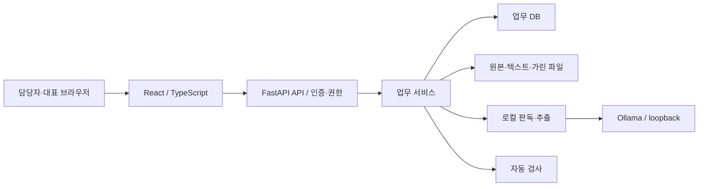
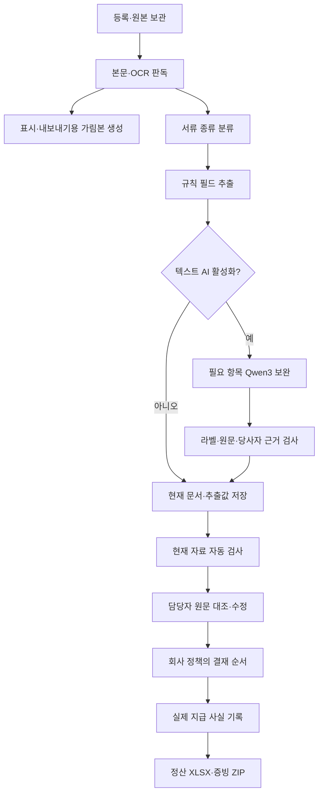

# 현재 시스템 구성과 업무 흐름

> 상태: 현재 기준
> 확인일: 2026-10-09
> 기준: 2026-10-09 구조 정리 소스 사본. 현재 소스와 과거 설치·평가 기록의 검증 범위를 구분한다.

관련 소스: [main.py](../../backend/app/main.py) · [__init__.py](../../backend/app/ai/__init__.py) · [pipeline_service.py](../../backend/app/services/pipeline_service.py) · [vlm_reread_service.py](../../backend/app/services/vlm_reread_service.py)

## 실행 구성

pilot 모드는 지정 자료 폴더의 SQLite를 사용한다. 개발 모드는 설정에 따라 SQLite 또는 PostgreSQL을 사용할 수 있다. 개발·검증 자료는 별도의 pilot 업무함으로 분리한다. 운영 시 FastAPI가 빌드된 `frontend/dist`를 제공한다. 다른 직원은 서버 PC의 브라우저 주소로 접속하며 Ollama는 서버 PC 내부 loopback에 둔다.

## 기본 문서 분석

가림본 생성과 로컬 AI 입력은 다른 정책이다. 텍스트 보완은 로컬 원문 텍스트, VLM은 원문 이미지를 받을 수 있다. 가림 ON이 AI 입력까지 모두 가린다는 뜻은 아니다. 국세청 조회는 pilot·평가에서 disabled이며 세금계산서 진위 검증을 제공하지 않는다.

## 수동 이미지 재판독

후보 생성은 저장값·검수·결재를 바꾸지 않는다. 모델의 문구·좌표를 독립 검증된 OCR 근거로 등록하지 않는다. 확인 저장은 기존 필드 정정 경로를 사용하고 이전 자료에 대한 결재·지급 연결의 유효성을 다시 확인하게 한다.

업무함은 10초 간격으로 조회한다. 상세 입력을 덮어쓰지 않고 자료 변경 안내를 표시한다. 실제 메일·송금·ERP 자동 업로드는 구현 범위에 포함되지 않는다. 상세 정책은 [분석 흐름](../ai/pipeline.md), [검수 규칙](../validation/current_rules.md), [API 연결](../api/README.md)에서 관리한다.

[전체 문서](../README.md) · [현재 구현 상태](../progress/current_status.md)
