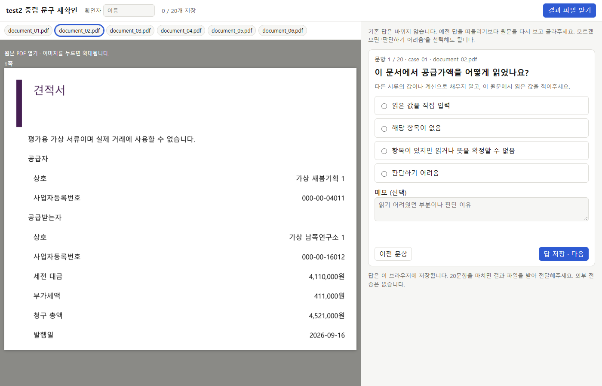
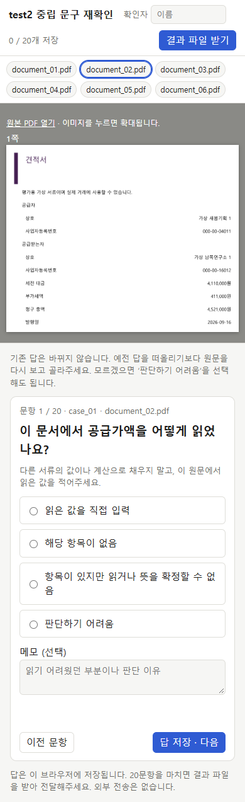

# 중립 재확인 페이지 QA

확인 대상: `eval/human_review_page_test2_neutral/index.html`. 원래 앱 frontend와 독립된 평가 페이지다. Browser 플러그인이 제공되지 않아 frontend-testing-debugging 스킬의 대안 절차인 번들 Playwright + 설치된 Chrome을 사용했다. 임시 서버는 127.0.0.1:8093이며 운영 앱·DB는 사용하지 않았다.

| 확인 | 결과 |
| --- | --- |
| 페이지 제목·첫 문항·원문 sentinel | test2 중립 문구 / 공급가액 질문 / case_01 document_02.pdf 일치 |
| 데스크톱 1400×900 | 원문·질문 나란히 표시, 이미지 정상 로딩 |
| 좁은 화면 390×844 | 원문 위·질문 아래, 가로 넘침 없음, 선택 후 다음 이동 |
| 초기 상태 | 답 미선택, 이전 답·정답 은닉, 비교 불필요 문항은 등록 계약 상자 숨김 |
| 입력 검증 | 무응답 및 숫자 칸의 문자 입력 차단 |
| 저장·복원 | 입력 후 다음, 새로고침 뒤 저장 수·입력값 복원 |
| 전체 완료·내보내기 | 격리된 QA 답 20개와 QA 이름으로 JSON 다운로드 성공 |
| 비교 도구 연결 | 임시 QA 파일만 메모리에서 읽어 불일치 1·판단 어려움 19 구분. 실제 결과로 저장 안 함 |
| 콘솔 | 오류 0개 |

QA는 합성 클릭이며 사람 원문 재확인을 대신하지 않는다. 임시 파일은 QA_ONLY로 표시하고 실제 평가 결과로 가져오지 않았다. 원래 사람 응답·정답은 변경하지 않았다. 아래 화면에는 QA 답을 넣기 전 초기 상태를 담았다.

