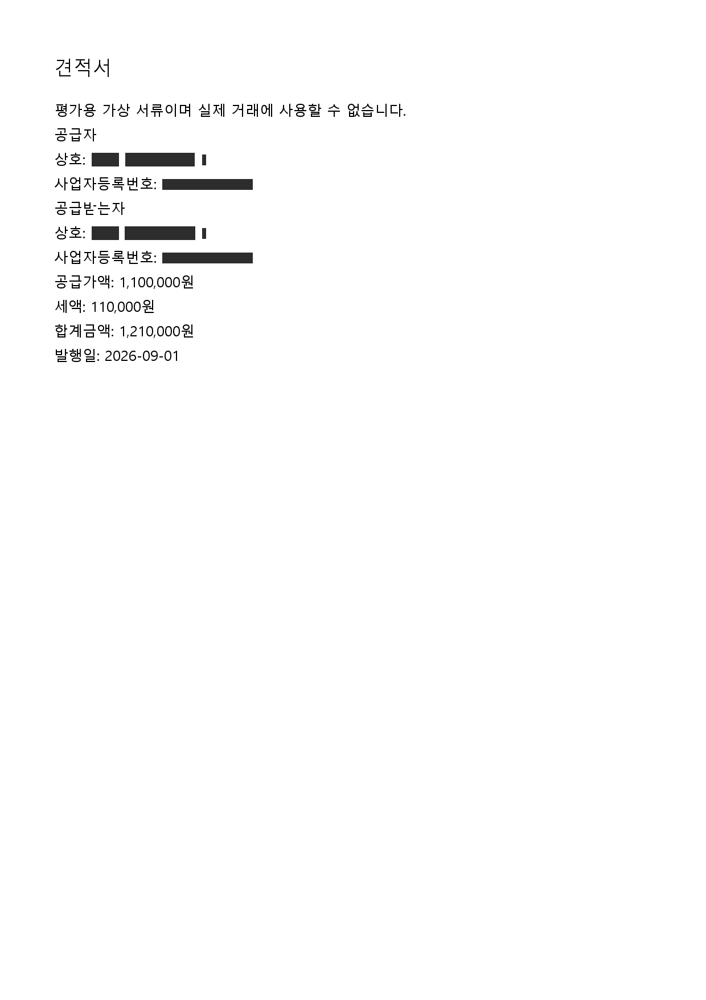

# 고객 점검 후 백엔드 보완

관련 변경 위치는 [API 인계](../../api/frontend_handoff.md), 측정 절차는 [작업시간 비교 초안](../../operations/team_test_measurement.md)에 있다. frontend는 Claude의 별도 브랜치에서 연결한다.

## 합의와 완료 사항

| 항목 | 반영 |
| --- | --- |
| 사람 확인 범위 | 기존 `6af74e2`의 칸별 확인에 더해 수정 API에서 부분 fields를 병합. 생략한 칸 유지, 명시 null만 제거. confirmed_fields는 같은 값의 원문 확인을 기록 |
| PNG 가림 | 여러 OCR 단어의 회사명을 라벨·알려진 값으로 함께 가림. 발행일을 오인하던 짧은 번호 패턴 제거. 미리보기·가린 이미지 다운로드·계약 ZIP에 적용 |
| 계약 한 건 묶음 | 현재본+이전본, 등록 기준·필드, 저장된 검수 결과, 요청·수정·최종 확인·결재·맡기기 이력을 ZIP으로 제공 |
| 미연동 국세청 | 도우미는 INFORMATIONAL_NOTICE/actionable=false. 요청·맡기기 초안 없음 |
| 앱이 못 읽은 값 | AMOUNT_EXTRACTION 등은 VERIFY_EXTRACTION_FIRST. 원문부터 확인하며 거래처 요청 초안 없음 |
| 요약 건수 | 같은 문서의 여러 검사를 화면과 같은 문제 카드로 묶음. 카드 수/검사 수 별도 제공. 기존 목록의 검사 수와 판정·평가 유지 |
| 기존 방식 비교 | 정상·누락·재발행 세 과제, 동일 완료 조건, 수행 순서 교차, 처리 대기 포함·외부 연락 대기 제외, 실패·도움도 함께 기록하는 초안 |

수정창 원래 값과 요청 문구의 거래처명은 업무상 필요하다는 사용자 결정에 따라 유지하며 안내는 frontend 담당이 추가한다. 상단 상호 보호 표기도 실제 범위에 맞춰 frontend가 정리한다. 재발행 화면은 `feat/ui-polish`의 `bc0f575`에 이미 있어 다시 만들지 않았다. 비동기 업로드 작업 화면은 동결 전 추가하지 않는다.

## 자료 묶음의 범위와 보호

`GET /api/contracts/{id}/export?masked=true&revision=현재값`. 가림 기본 ON. 담당자·대표·관리자 인증과 회사 접근 권한을 적용한다. 다른 계약·전체 DB·로그인 정보·서버 경로는 포함하지 않는다.

가림 ON: PDF는 가린 이미지만 담은 PDF, PNG 등은 가린 PNG, Word 등은 저장된 본문을 가린 TXT다. TXT는 원문 배치를 보존하지 않는다. 회사명·번호 등 알려진 민감값은 메타데이터와 과거 수정 이력에서도 가리되 파일 검증용 해시는 그대로 둔다. PDF의 회전된 페이지와 스캔 페이지는 표시된 이미지의 OCR 위치로 가린다.

원본 누락·해시 불일치·생성 중 자료 변경은 409, 가림 실패는 503이며 일부 ZIP이나 원본으로 대체하지 않는다. 원본 100개·250MB, 변환과 이력을 포함한 내용 250MB를 제한한다. 생성 중 DB 읽기 트랜잭션을 해제하고 전송 뒤 임시 파일을 정리한다. 검수·결재·revision은 바꾸지 않고 묶음 준비 성공 감사 이벤트만 남긴다. 이 이벤트는 완전 수신 증명이 아니다.

OCR로 읽히지 않은 민감 정보까지 완전히 제거했다고 주장하지 않는다. 현재 수정은 표시·내보내기 전용으로, 동결된 모델·프롬프트·가드·정답·평가 경로를 바꾸지 않았다.

## 검증

- 부분 수정·명시 확인, 국세청 안내·원문 확인 우선, 문제 카드 집계, ZIP 현재/이전본·타 계약 제외·역할 인증·메타데이터 가림·실패 시 원본 차단·원본 해시·동시 변경·임시 파일 정리·크기 제한을 검사했다.
- 실제 DOCX는 가린 TXT, 스캔 PDF는 가린 이미지 PDF로 내려받으며 숨은 텍스트를 담지 않음을 검사했다.
- 기존 dev `case_01/document_02.png`의 Windows OCR 12줄을 확인했다. 공급자·공급받는자의 여러 단어 상호와 두 사업자번호를 가리고, 발행일 `2026-09-01`과 금액은 유지했다. 아래는 표시용 가림 결과다. AI 판독을 재실행한 성능 평가가 아니다.

백엔드 전체 381개, frontend 테스트 14개와 빌드가 통과했다. 로컬 커밋만 남기며 push·PR은 하지 않는다. 시간 비교는 아직 초안이며 실측 절감 수치가 없다. 남은 작업은 Claude의 화면 연결, 병합 전 알림·통합 검증, 화요일 과제 수행과 실제 시간 기록이다.
