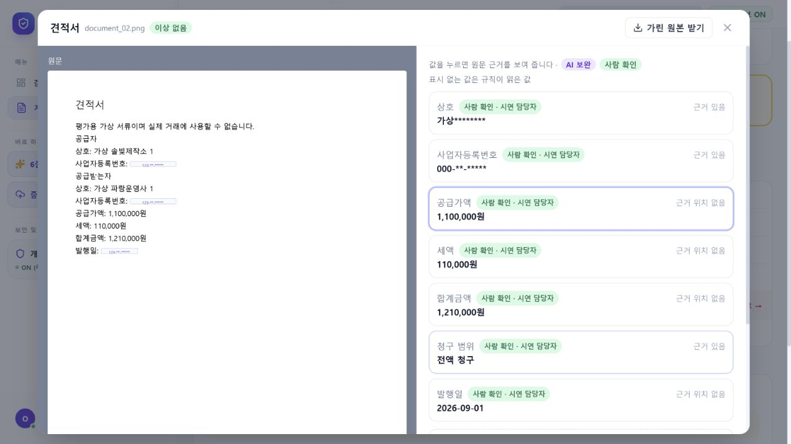
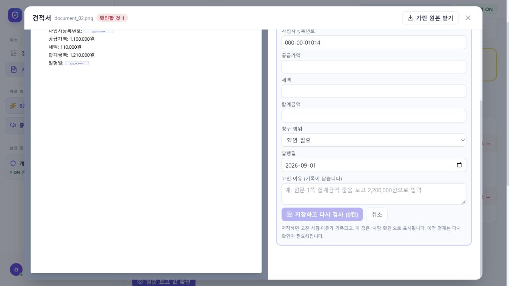
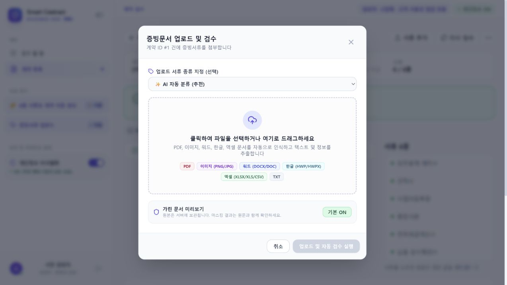
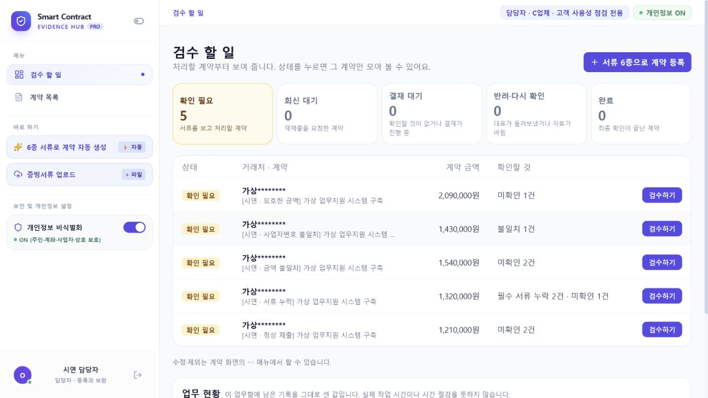
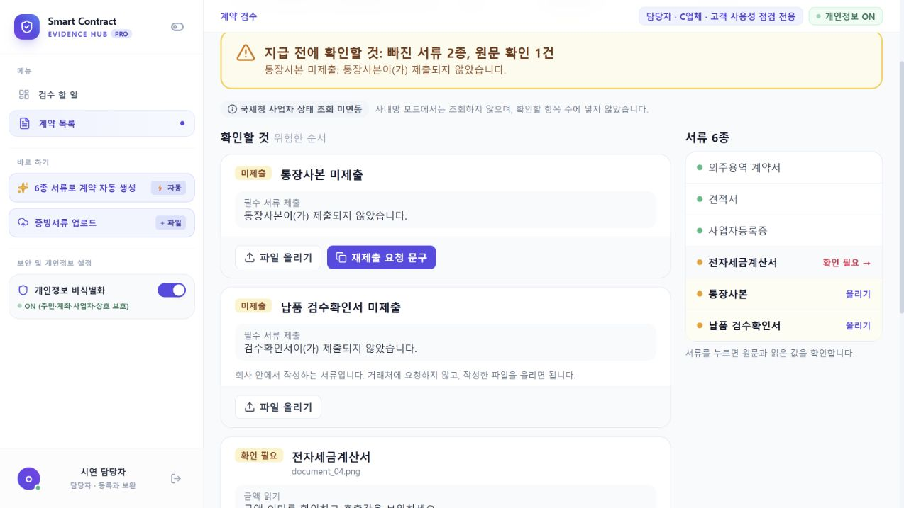
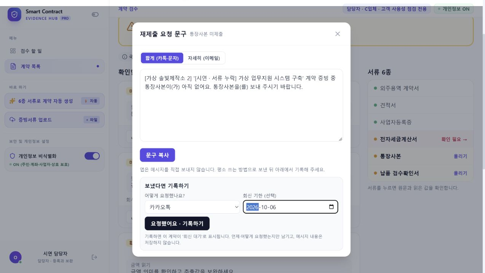
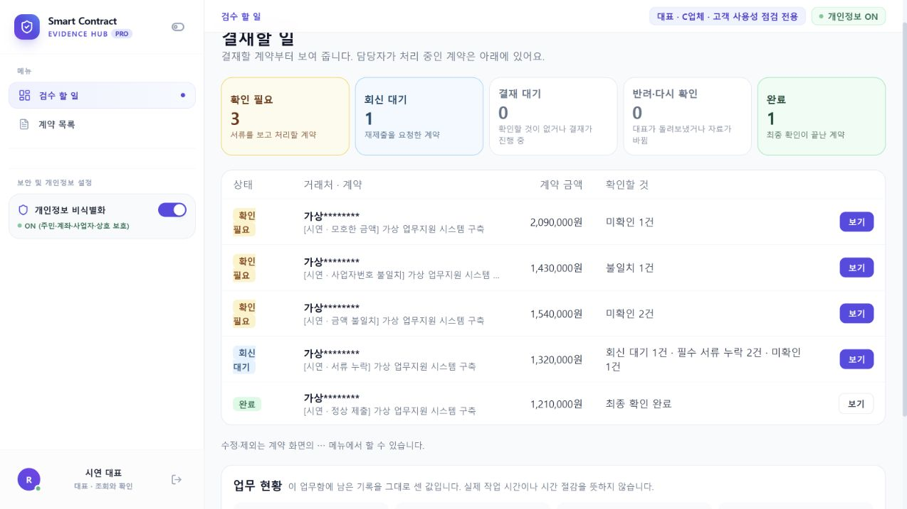
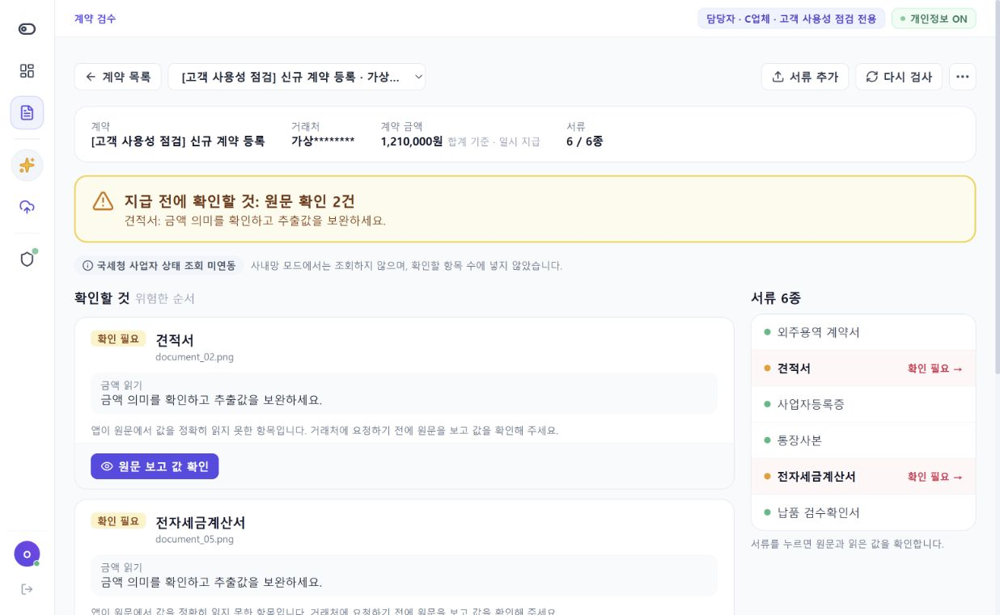

# C-Pilot 고객 관점 실사용 점검과 제품 방향

점검일: 2026-10-03. 담당자 1명과 대표가 쓰는 소기업 C업체를 가정했다. 실제 고객 인터뷰 결과가 아니라, AI 에이전트가 고객 역할을 수행한 사용성 점검과 공식 제품 자료 조사다.

## 판단

**문서를 읽고 결과를 보여 주는 수준을 넘어, 보완 요청과 대표 확인까지 이어지는 업무함이 됐다. 다음 투자는 기능 수보다 기록의 정확성과 수정 서류 처리에 두는 것이 좋다.**

제안하는 제품 설명은 **“작은 회사의 담당자가 계약·증빙의 빠진 부분과 다른 금액을 정리하고, 대표 확인까지 끝내는 사내 서류 업무함”**이다. 로컬 AI·원문 근거·간단한 결재가 이를 뒷받침한다. 실제 구매 의향과 시간 절감은 별도 고객 테스트가 필요하다.

## 점검 범위와 안전한 실행

- 실사용 서버: localhost 8040, `storage/demo/customer-audit-20261003/`의 독립 업무함.
- 기존 dev 시연 자료의 규칙 모드 사본만 사용했다. 초기 5계약·28문서에서 신규 등록 후 6계약·34문서가 됐다. 원래 업무함과 실제 고객 자료는 수정하지 않았다.
- 담당자·대표용 가상 계정으로 로그인했다. 계정은 점검용으로 활성화해 준비했으므로 최초 비밀번호 변경, 계정 복구, 2차 인증은 실사용 검증 범위에 넣지 않았다.
- 국세청 조회와 로컬 LLM은 껐다. 신규 업로드는 규칙/OCR 경로로 처리했으며 이번 결과로 AI 정확도·속도·가드 효과를 판단하지 않는다.
- test/test2 문서·정답은 이번 감사에 사용하지 않았다. 모델·프롬프트·가드·평가 코드와 frontend 소스는 수정하지 않았다.
- 시작 시 코드 HEAD `c79883e`, frontend 최근 변경 `ddecb75`. 사용한 기존 정적 빌드는 `index-BOHyN5ip.js` / `index-CGMCaqYZ.css`, index 파일 시각 2026-10-03 01:57 KST. 별도 UI 브랜치의 미병합 변경에 대한 평가는 아니다.
- 브라우저는 Codex 내장 브라우저. 현재 실행에서 직접 캡처한 화면만 아래 근거로 사용했다. 창 크기가 작업 중 달라져 화면별 크기가 다르다. 고정 해상도 비교·전체 접근성 심사는 하지 않았다.
- 외부 메시지는 보내지 않았다. 요청 기록과 대표 확인은 가상 데이터에서만 수행했고 메모에 AI 사용성 점검임을 명시했다. 평가 정답의 사람 검수 기록으로 사용하지 않는다.

## 직접 수행한 흐름

| 흐름 | 결과 | 고객 관점 판단 | 화면 |
| --- | --- | --- | --- |
| 로그인 → 담당자 할 일 | 확인 필요·회신 대기·결재 대기·완료 구분 | 시작할 위치가 분명함 | [로그인](screenshots/01-login.png), [업무함](screenshots/02-operator-tasks.png) |
| 누락 계약 확인 | 통장사본은 거래처 요청, 검수확인서는 내부 작성으로 안내 | 불필요하게 거래처에 연락하는 일을 줄일 수 있음 | [누락 안내](screenshots/03-missing-contract.png) |
| 요청 문구 → 요청 기록 | 카카오톡 요청을 가상 기록하자 회신 대기 1건으로 전환 | 평소 연락 수단을 유지하는 방식이 C업체에 맞음 | [문구](screenshots/04-request-draft.png), [대기](screenshots/05-waiting-dashboard.png) |
| 원문 확인 → 값 보완 | 견적 4칸, 세금계산서 3칸 보완 후 자동 재검사 | 원문과 입력을 함께 보는 구조가 좋음. 확인 출처 표시 오류는 수정 필요 | [대조](screenshots/06-source-review.png), [보완 후](screenshots/08-correction-saved.png) |
| 담당자 보완 → 대표 결재 | 대표의 결재 대기 1건 → 메모·확인 후 완료 1건 | 역할에 따라 다음 업무가 이어지고 당시 기록도 열 수 있음 | [대표 업무함](screenshots/10-representative-queue.png), [완료](screenshots/13-completed-dashboard.png) |
| 회신 처리 | 회신 대기가 해제돼도 미제출 서류와 확인 항목은 남음 | 연락을 받았다는 것과 증빙 보완 완료를 구분함 | [미제출 유지](screenshots/14-reply-without-evidence.png) |
| 신규 계약 등록 | dev PDF·PNG·DOCX 6개 → 초안 → 제목 수정 → 저장 → 6종 등록 및 검수 | 이미 있는 문서 묶음으로 계약을 만드는 흐름은 동작함 | [추출 초안](screenshots/16-registration-extracted.png), [등록 결과](screenshots/17-created-contract.png) |

요청 기한 입력 화면은 열어 보았으나 저장·기한 초과 처리를 이번 감사의 통과 항목으로 집계하지 않았다. 서버 재시작·업로드 실패 복구·수정본 실제 교체·동시 사용자·백업 복원은 별도 검증이 필요하다. 한 번의 성공 흐름을 전체 안정성 보증으로 해석하지 않는다.

## 가장 먼저 다룰 네 가지

### 1. 일부 수정이 전체 사람 확인으로 바뀌는 문제 — 직접 재현

견적서에서 공급가액·세액·합계·청구 범위 **4칸**을 바꿨다. 저장 버튼도 4칸으로 표시했다. 저장 뒤에는 바꾸지 않은 상호·사업자번호·발행일을 포함한 **7칸 전부**에 `사람 확인 · 시연 담당자`가 붙었다.

대표는 실제 확인 범위보다 넓게 검증됐다고 받아들일 수 있다. 필드별 확인과 문서 전체 확인을 구분해야 한다. 바뀐 칸만 제출하는 것에 더해, 서버의 출처 계산도 필드별 기록을 사용해야 한다. 문서 전체 확인이 필요하다면 별도 명시 행동으로 받아야 한다.

코드 근거: [DocumentReviewDialog.tsx:73](../../../frontend/src/components/review/DocumentReviewDialog.tsx)에서 변경 수를 계산하지만 저장은 전체 draft를 보낸다. [documents.py:180](../../../backend/app/api/documents.py)는 문서 전체 확인 상태를 설정하고, [review_context_service.py:40–72](../../../backend/app/services/review_context_service.py)는 이를 모든 필드에 적용한다.

완료 기준: 한 칸만 수정·확인하면 해당 칸만 사람 확인으로 바뀌고, 다른 규칙/AI 값의 출처와 확인 필요 상태는 유지된다.

### 2. 개인정보 가림 표시와 실제 화면의 불일치 — 직접 재현

`개인정보 ON (주민·계좌·사업자·상호 보호)` 상태에서 다음을 확인했다.

- 값 조회 카드의 사업자번호는 가려졌지만, `값 고치기` 입력창에는 원래 번호가 표시됐다.
- 요청 문구에는 원래 거래처명이 표시됐다.
- 가린 PNG 미리보기에도 공급자·공급받는자 상호가 남았다. 반대로 발행일은 가려져 업무 판독을 방해했다.

원래 값을 수정·복사할 필요는 있지만, 가림 표시와 예외가 서로 맞아야 한다. 수정 화면의 원문 값 공개는 명시적으로 알리고, 미리보기·요청 문구·다운로드의 가림 정책을 함께 점검하는 것이 우선이다. 이를 외부 침입이나 접근 권한 우회로 재현한 것은 아니다. **어깨너머 보기·화면 공유에서 가림을 믿기 어려운 문제**다.

코드 근거: [수정 입력창](../../../frontend/src/components/review/DocumentReviewDialog.tsx)은 원래 draft를 그대로 표시한다. [RequestDraftDialog.tsx](../../../frontend/src/components/review/RequestDraftDialog.tsx)는 선언된 마스킹 속성을 실제 문구 생성에 사용하지 않는다. 이미지 상호 미가림은 [visual_masking.py](../../../backend/app/ai/visual_masking.py)의 단어 단위 일치 방식이 원인 후보이며, 해당 OCR 토큰까지 분석한 확정 원인은 아니다.

완료 기준: 같은 문서에 대해 조회·편집·요청 문구·미리보기·다운로드의 보호 범위를 일관되게 설명하고, 노출 예외는 사용자가 인지한 상태에서만 연다. 시각 변경은 계획·시안 승인 후 진행한다. 동결된 AI 파일에 영향을 주는 수정은 평가 버전과 분리해야 한다.

### 3. 수정해서 받은 서류를 이전본과 연결하기 — 화면 공백 + 코드 확인

현재 `서류 추가` 화면에는 서류 종류와 파일 선택만 있고, `기존 서류의 수정본` 선택이 없다. 고객이 금액을 고친 세금계산서를 다시 받았을 때 어떻게 넣을지 불분명하다.

백엔드에는 이미 ADD/REISSUE, 교체 대상, 이전본 보존과 버전 비교가 있다. 프런트 업로드는 기본 ADD 경로를 호출한다. **버전 기능을 새로 설계하기보다 이미 있는 기능을 연결할 일**이다. 이번에는 수정본 업로드로 잘못된 합산까지 재현한 것은 아니다.

코드 근거: [client.ts](../../../frontend/src/api/client.ts), [documents.py:47–101](../../../backend/app/api/documents.py).

완료 기준: ‘새 서류 / 기존 서류 수정본’을 구분하고, 수정본을 등록하면 현재본은 하나로 정해진다. 이전본·변경 이유·변경 전후 값은 보존되고, 필요한 재검사·재결재가 이어진다.

### 4. 업로드 진행과 실패 복구를 화면에 연결하기 — 코드 확인, 장애 미재현

신규 6종 등록은 성공했다. 다만 고객은 초안 추출 대기와 계약·문서 등록 대기를 차례로 거치며, 처리 중 창을 닫거나 실패했을 때 이어서 확인할 장치가 중요하다.

백엔드에는 `document-jobs` 접수·상태·재시도가 있지만 현재 화면은 동기 업로드를 기다린다. 장애가 났다고 주장하는 것이 아니라, 이미 준비된 복구 기능이 화면에 연결되지 않은 상태다.

코드 근거: [upload_jobs.py](../../../backend/app/api/upload_jobs.py), [ContractDashboard.tsx:195–214](../../../frontend/src/pages/ContractDashboard.tsx).

완료 기준: 파일별 처리 중·완료·실패와 재시도를 보여 주고, 새로고침 후 상태를 이어서 확인한다. 재시도가 중복 문서를 만들지 않는지 검증한다.

## 그다음 개선과 추가

| 순서 | 제안 | 범위를 작게 잡는 방법 |
| --- | --- | --- |
| 다음 연결 | 실제 AI 사용 상태 | ‘꺼짐 / 연결 미확인 / 연결 실패 / 이 서류에 AI 보완 사용’을 구분. 기존 상태 API 연결부터. 로컬 LLM이 꺼진 이번 점검에서도 업로드에는 ‘AI 자동 분류’라는 넓은 표현이 있어 구체 설명이 필요함 |
| 다음 개선 | 대표 확인 문구와 요약 | 대표 목록의 ‘담당자 최종 확인 필요’ 문구를 현재 결재 역할에 맞춤. 기존 계약 요약 API로 ‘무엇이 달랐고 누가 어떻게 처리했는지’ 짧게 제시 |
| 작은 추가 후보 | 계약 한 건 완료 자료 묶음 | 현재본 서류 + 검수 결과 + 확인 이력을 계약 단위로 내보내는 기능. 개별 파일 받기·전체 업무 백업과 목적이 다름. 전달용 가림 여부를 명시 |
| 검증 우선 | 실제 작업 시간 측정 | 정상·누락·수정본 세 과제를 기존 방식/앱으로 처리해 완료 여부, 도움 요청, 실제 작업 시간, 잘못된 완료 여부를 기록. 지금의 대기 포함 경과시간을 절감 시간으로 쓰지 않음 |
| 운영 단계 | 설치·백업 복원·계정 인수인계 | 기존 실행기·퇴사자 중지·백업 기능을 실운영 시나리오로 검증. 판매 준비 때 HTTPS·복구·업데이트 절차를 별도 과제로 확정 |

계정 생성·중지, 초기 비밀번호 변경, 로그인 시도 제한, 역할 권한, 세션 폐기, 백업은 이미 코드에 있다. 이번에 새로 없다고 분류하지 않았다. 2차 인증과 자동 업데이트, 자동 HTTPS 구성은 판매 운영 단계에서 다룰 범위다. 백업의 암호화·보관 정책과 복원 성공 여부는 출시 전 별도 확인이 필요하다.

현재 C업체는 담당자 한 명이므로 복잡한 배정·다단계 결재·범용 챗봇을 먼저 넓힐 필요가 적다. 자동 송금, 급여·세무 전체, 전자서명까지 한꺼번에 추가하는 것도 현재 목표 밖이다.

## 다른 제품에서 참고할 점

2026-10-03 공식 제품/도움말 자료를 조사했다. 경쟁 제품에 가입하거나 직접 업무를 처리한 비교는 아니며, 기능 유무의 전수 비교·속도·가격 대비 우열을 주장하지 않는다.

| 제품 | 공식 자료에서 확인한 흐름 | 우리에게 적용할 방향 |
| --- | --- | --- |
| [모두싸인 캐비닛](https://modusign.co.kr/cabinet) | 문서 분류·정보 추출, 계약 검색, 일정·리마인더 | 읽은 뒤에도 ‘찾기’와 ‘언제 처리할지’를 해결. 현재 업무함의 검색·기한 흐름을 유지·정리 |
| [경리나라](https://kyungrinara.com/home/home_1000.html) | 증빙 수집, 거래처·지출 관리, 보고·결재 | 검수 결과를 다음 업무에 넘길 수 있는 완료 자료를 제공. 회계·이체 전체를 복제할 필요는 적음 |
| [Rossum](https://knowledge-base.rossum.ai/docs/guide-to-automation-process-in-rossum) | 자동 검증과 사람 검토를 나누고 검증 출처를 설명 | 사람이 실제 확인한 칸과 자동 처리한 칸을 정확히 구분. 가드 설명도 ‘왜 다시 확인해야 하는지’에 집중 |
| [DocuWare](https://knowledgecenter.docuware.com/docs/preconfigured-solutions-invoice-processing-uk) | 문서 검증 → 결재·반려 → 완료·내보내기 | 검사 통과와 업무 완료를 구분하고 보완 후 다시 이어지는 흐름을 마무리 |

사내망 운영을 우리만의 기능으로 주장하면 안 된다. [DocuWare는 온프레미스 구조](https://knowledgecenter.docuware.com/help/docs/docuware-on-premises-tier-architecture)를 지원한다. 모두싸인 캐비닛 페이지는 AWS 저장을 명시하며, 별도로 [구축형 전자계약](https://blog.modusign.co.kr/news/notice/2025-summary)도 소개한다. 제품별 배포 형태와 외부 통신 여부는 구분해야 한다.

**우리 방향은 작은 회사에 필요한 교차 확인·원문 근거·보완 기록·간단한 결재를 적은 설정으로 묶는 것**이다. 고객 수요는 인터뷰·과제 테스트로 확인하고, 경쟁사 홍보상의 시간 절감 수치를 우리 효과 근거로 쓰지 않는다.

## 실행 순서와 역할 제안

1. Codex: 필드별 확인 출처와 가림 문제의 서버 영향 범위를 정리하고 재현 가능한 검증 조건을 준비한다. 동결된 평가 버전과 충돌하는 변경은 별도 버전으로 관리한다.
2. Claude: 승인받은 계획/시안을 바탕으로 수정본 업로드·처리 상태를 연결한다. 기존 버전/작업 API를 활용한다.
3. 함께: 정상 한 건, 누락 보완 한 건, 수정본 교체 한 건을 등록부터 대표 확인까지 다시 수행한다. 시간과 도움이 필요했던 지점을 기록한다.
4. 이 세 과제가 끝나면 계약 단위 완료 자료 묶음과 대표 요약 중 고객이 더 필요로 하는 것 하나를 추가한다.

이 보고서는 개선안이다. 화면·업무 로직 수정은 수행하지 않았다. 새 디자인이 필요한 변경은 사용자에게 계획과 이미지 시안을 보여 주고 승인받은 뒤 구현한다.

## 추가 화면 근거

나머지 캡처는 `screenshots/`에 보관했다. 초기 좁은 창 캡처 `15-new-contract-form.png`는 판독 크기가 작아 주요 판단 근거에서 제외했다.

## 점검 후 사용자 결정과 후속 반영

위 캡처와 판단은 main의 당시 빌드 기준이다. 재발행 화면은 이후 `feat/ui-polish`의 `bc0f575`에 연결됐으며, 현재 미구현이라는 판단으로 쓰지 않는다. 업로드 작업 화면은 동결 전 제외하기로 했다.

수정창 원래 값과 요청 문구의 거래처명은 업무상 필요하므로 frontend 안내를 추가한다. 이를 일괄 숨기는 개선안은 채택하지 않았다. PNG 미리보기의 상호 누락·발행일 오가림은 표시 전용 서버 코드에서 수정했다. 칸별 확인은 `6af74e2`로 범위를 분리했고, 부분 수정 요청도 나머지 값을 유지하도록 보완했다.

추가 기능은 계약 한 건 ZIP으로 결정해 서버 API를 구현했다. 도우미의 NTS 안내·원문 확인 우선과 요약의 카드 수를 맞췄다. [후속 작업 기록](../../progress/history/24_contract_bundle_and_display_alignment.md)과 [기존 방식·앱 작업시간 비교 초안](../../operations/team_test_measurement.md)에 범위·검증·남은 화면 연결을 정리했다. 현재까지 실제 시간 절감은 측정하지 않았다.
