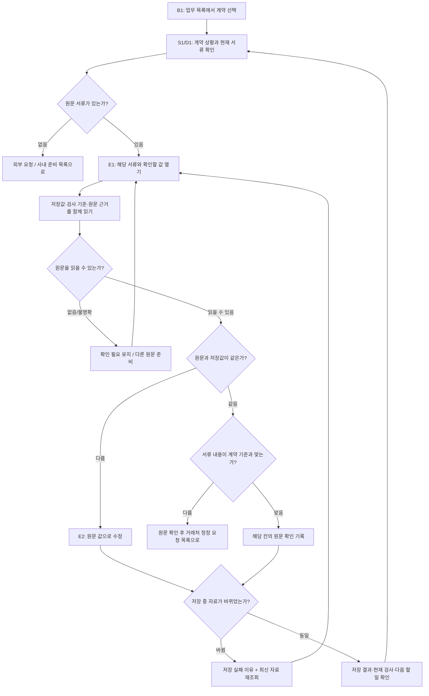
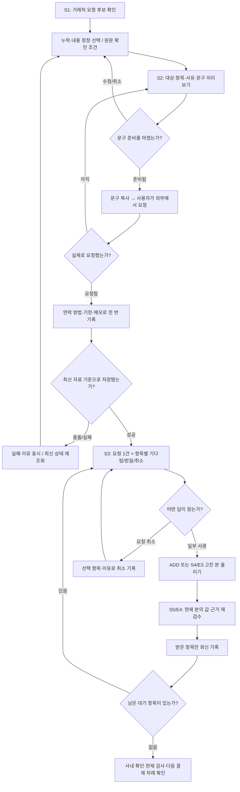
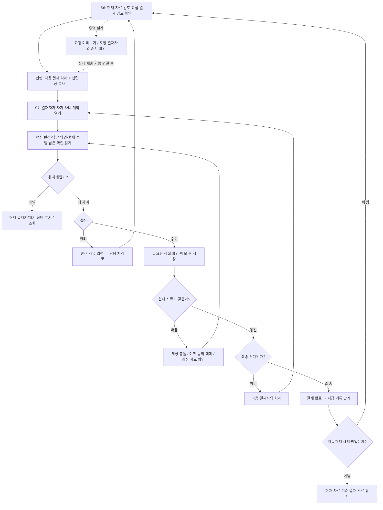

# 계약 검토 UI·UX·AX 상세 흐름 초안

2026-10-06. [ERP 화면 연구](../research/erp_uiux_ax_research_20261006.md)의 설계 산출물이다. 기존 Claude HTML c55a40d의 화면 ID를 연결했다. 사용자와 시스템의 상태 변경·취소·오류·복귀를 설계하기 위한 초안이며, 아래 흐름을 모두 새로 구현/검증했다는 뜻은 아니다.

## 1. 등록 → 원문과 값 확인

입구와 복귀는 같은 계약·같은 현재 서류를 유지한다. 원문 위치가 없으면 위치를 만들어 그리지 않는다. 판독 실패를 계약 기준값으로 채워 통과시키지 않는다. 전체 서류 확인과 한 칸 확인은 화면에서 구분한다.

| 화면/행동 | 사용자가 보고 결정할 것 | 취소·오류·복귀 |
| --- | --- | --- |
| C1/C2 새 계약 등록 | 선택 파일·종류·읽힌 계약 기준·금액 기준·누락 | 실패 파일을 구분하고 같은 작업의 재시도/선택 제거. 새 창/다른 계약에 파일이 섞이지 않아야 함 |
| E1 원문 열기 | 현재 본·확인할 값·근거·출처·확인 상태 | 원문 로딩 실패는 원문 확인 완료와 구분. 목록 선택/위치 유지 |
| E2 값 수정 | 원문 값과 수정 사유·명시적 확인 칸 | 취소하면 저장하지 않고 E1로. 자료 충돌은 최신 상태에서 다시 검토 |
| E3 고친 본 | 교체할 현재 문서·새 파일·사유 | ADD와 REISSUE 구분, 취소하면 파일/사유 초기화. 실패면 현재 본은 그대로라는 실제 결과 표시 |
| E4/S5 저장 뒤 확인 | 현재 본·이전/현재 차이·검사 결과 | 비교 실패를 ‘같음’으로 표시하지 않음. 다음 원문 확인/회신 기록으로 연결 |

## 2. 묶음 요청 → 부분 회신 → 재검수

‘받음’은 받은 사실이며 내용 일치나 검토 완료와 같은 표시가 아니다. 잘못 온 파일이나 다시 틀린 서류는 현재 검사에서 계속 확인해야 한다. 사내 준비/판독 문제를 거래처에 포함하지 않는다. 문구 복사만으로 요청 기록이 만들어지지 않는다.

| 상태 | 기본 화면에서 보일 것 | 다음 행동 |
| --- | --- | --- |
| 요청 준비 | 거래처·항목·사유·선택 건수 | 문구 검토, 선택 수정, 취소 |
| 실제 요청 전 | 준비한 문구, 아직 기록 전 | 복사하거나 창 닫기. 화면 내부 임시 입력과 DB 초안 저장은 구분 |
| 대기 | 총 요청/받음/기다림/취소 | 받은 자료 올리기, 받은 항목만 기록, 항목 취소 |
| 부분 회신 | 이번에 받은 항목과 남은 대기 | 받은 자료 검토 후 해당 항목만 기록 |
| 기한 지남 | 남은 항목·기한 | 기존 요청 확인, 실제 재연락 후 기록. 자동 발송됐다고 표시하지 않음 |
| 회신 저장 충돌 | 저장하지 못한 이유, 실제 재조회 결과 | 최신 상태에서 다시 선택. 상단 공지는 단계가 바뀌어도 유지 |

## 3. 결재 검토 → 반려·재결재

아래 검토/반려/자료 변경은 기존 흐름을 UX 관점에서 정리한 것이다. **명시적인 요청 제출 창과 지정된 사람 3~5명의 N단계 결재 구간은 후속 설계 제안**이다. 현재 서버는 담당 검토/대표 최종 확인 최대 2단계다.

3~5명 시안에서는 지금 차례/다음 차례/완료/반려/이전 자료 기준의 기록을 구분한다. 단계가 많아져도 한 화면에 모든 의견과 이력을 기본으로 펼치지 않는다. 병렬 전원/한 명 승인은 위 순차 다이어그램으로 완료 기준을 대신하지 않는다.

이미 지급한 계약은 결재 검토와 지급 재확인을 구분하고 기존 ‘다시 지급하지 마세요’ 안내를 눈에 띄게 둔다. 대표 결재 화면의 결정은 실제 송금이 아니다.

## 각 화면을 설계할 때 채울 카드

| 설계 항목 | 적을 내용 |
| --- | --- |
| 진입 | 어느 목록/계약/서류/버튼에서 열리는가 |
| 과제 | 사용자가 여기서 마칠 한 가지 일 |
| 대상 | 계약·현재 본·현재 값·요청/결재 회차 |
| 정보 | 처음 보여 줄 것 / 필요할 때 펼칠 것 |
| 주 행동 | 버튼 이름·활성 조건·성공 시 이동/갱신 |
| 보조 행동 | 원문 보기·이전본 비교·기록 펼치기 |
| 미완료 입력 | 뒤로/닫기/다른 계약/모드 변경 시 처리 |
| 예외 | 자료 변경·권한/차례 변경·로딩/저장 실패·중복 처리 |
| 피드백 | 성공/실패 이유·무엇이 저장됐는지·다음 할 일 |
| AX | 출처·근거·불명확/확인 상태·사용자가 수정하는 단위 |
| 접근성 | label·Tab 순서·초점·닫기/복귀·색 외 상태 표시 |

화면 ID와 이 카드를 연결한 뒤 시각 시안을 만든다. 정적 화면 목록이 전부 연결된 실제 상태 흐름을 뜻하지 않으며, 정상·취소·부분 완료·실패 후 복구를 눌러 보는 시안에서 확인한다.
